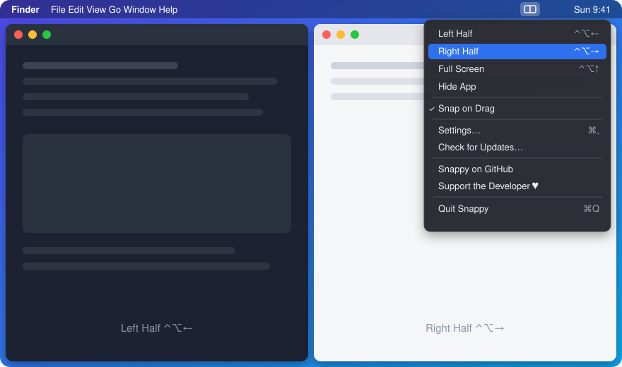

<p align="center">
  
</p>

<h1 align="center">Snappy</h1>

<p align="center">A tiny macOS menu bar app that snaps windows to the left half, right half, or full screen.</p>

<p align="center">
  <a href="https://github.com/jojonki/Snappy/releases/latest"></a>
  
  <a href="https://github.com/sponsors/jojonki"></a>
</p>

<p align="center">
  
</p>

## Features

- Snap the focused window to **Left Half**, **Right Half** or **Full Screen**
- Global keyboard shortcuts (customizable, or set to **None** per action)
- Snap by dragging a window to a screen edge
- Hide the frontmost app with a shortcut
- Automatic update check from GitHub Releases
- Quick links to this repository and to sponsorship from the menu

## Default shortcuts

| Action       | Shortcut |
|--------------|----------|
| Left Half    | ⌃⌘←      |
| Right Half   | ⌃⌘→      |
| Full Screen  | ⌃⌘↑      |
| Hide App     | None     |

Change them in **Settings…** from the menu bar icon.

## Install

Download `Snappy.dmg` from [Releases](https://github.com/jojonki/Snappy/releases), drag Snappy to Applications, then grant **Accessibility** permission when prompted (System Settings → Privacy & Security → Accessibility).

## Build

```sh
./build.sh                      # builds build/Snappy.app, .zip and .dmg
VERSION=0.1.2 ./build.sh        # set the version
NOTARY_PROFILE=<profile> ./build.sh   # also notarize
```

The app icon is generated from `Resources/icon.png`.

## Support

If Snappy is useful to you, please consider [sponsoring me on GitHub](https://github.com/sponsors/jojonki) ♥
You can also reach it from the menu bar: **Support the Developer ♥**.

Bug reports and feature requests are welcome in [Issues](https://github.com/jojonki/Snappy/issues).
